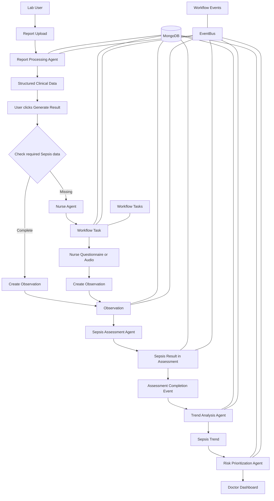
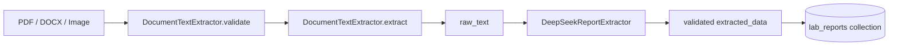
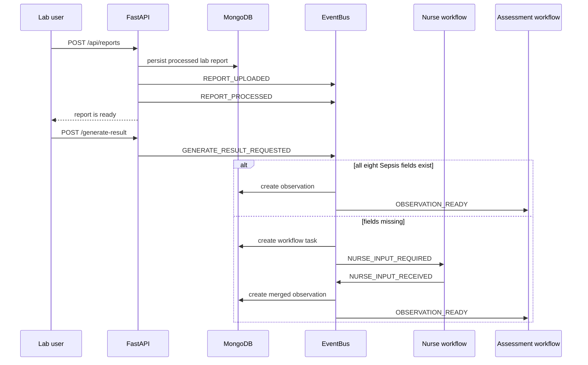
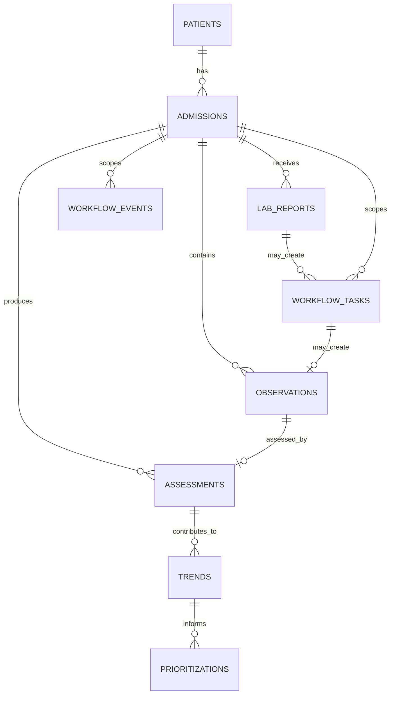

# Multi-Agent Clinical Decision Support System

## Overview Till Now

**Project:** Multi-Agent Clinical Decision Support System for Early Detection of Sepsis and Acute Kidney Injury (AKI)  
**Current implementation focus:** Sepsis report-to-dashboard workflow  
**Repository type:** Academic research prototype, not a clinically validated medical device

> **Important reading rule:** This document describes the current codebase as inspected. The active application workflow is Sepsis-focused. AKI remains in the architecture and assessment orchestration, but the current report and nurse input contract supplies the eight Sepsis features, so AKI will often be recorded as `insufficient_data`. AKI is not removed from the project.

> **Safety note:** Model outputs are estimates from an academic prototype. They are not medical diagnoses and must not replace qualified clinical judgment.

---

# 1. Project Overview

## 1.1 What problem are we solving?

A hospital patient can become seriously ill before the change is obvious. Important clues may be spread across laboratory reports, vital signs, nurse observations, and earlier measurements. A single value may look acceptable while the patient is gradually deteriorating.

This project collects those pieces of information, stores them against the correct patient and admission, converts them into assessment-ready observations, estimates Sepsis risk, follows risk over time, and gives a doctor a prioritized view of patients.

The project is therefore not only a machine-learning classifier. It is a workflow that connects:

- human users,
- uploaded documents,
- structured clinical values,
- a longitudinal patient history,
- disease-assessment agents,
- trend analysis,
- risk prioritization,
- MongoDB persistence, and
- frontend dashboards.

## 1.2 Why is early detection of Sepsis important?

Sepsis can progress quickly. Earlier recognition gives clinicians more time to review the patient, repeat measurements, investigate the cause of infection, and decide on treatment. The system is intended to help bring changing risk signals together earlier. It does not make treatment decisions automatically.

## 1.3 What is Sepsis?

Sepsis is a life-threatening reaction to infection in which the body's response can injure its own tissues and organs. It is a clinical condition that requires professional assessment. In this project, “Sepsis prediction” means an estimate produced by a trained model from structured observations; it does not mean that the system has diagnosed Sepsis.

## 1.4 Why can one normal-looking observation be insufficient?

A measurement is a snapshot. A heart rate of 90 may be less concerning by itself than a sequence of 80, 90, 105, and 120. A single normal oxygen saturation may also hide a recent downward pattern. The meaning of a value depends on patient context, time, other parameters, and whether the value is changing.

## 1.5 Why longitudinal patient data is needed

**Longitudinal data** means repeated observations collected over time for the same patient and admission. It allows the system to ask questions such as:

- Is the current value different from the earlier value?
- Is Sepsis probability rising or falling?
- Are several clinical parameters worsening together?
- Does the patient have enough history for a temporal model?

The repository stores observations chronologically and uses the history for Sepsis inference and trend analysis.

## 1.6 Purpose of the system

The purpose is to support a clinical team by:

1. accepting laboratory reports,
2. extracting recognizable clinical values,
3. identifying missing Sepsis inputs,
4. asking a nurse for missing information one question at a time,
5. creating a complete observation without inventing values,
6. estimating Sepsis risk,
7. comparing successful assessments over time,
8. prioritizing patients for review, and
9. displaying the result in a doctor-facing dashboard.

## 1.7 Intended users

### Doctor

The doctor reviews the patient list, latest Sepsis assessment, probability, risk level, trends, observations, and prioritization reason. The doctor remains responsible for interpretation and action.

### Nurse

The nurse receives persistent tasks when the report does not contain all required Sepsis inputs. The nurse answers the current question using structured input or audio. The system validates the answer and advances the task.

### Lab user

The lab user selects or creates a patient/admission context, uploads a report, waits for report processing, and explicitly clicks **Generate Result**. Uploading a report alone does not start a disease assessment.

## 1.8 What is a Clinical Decision Support System?

A **Clinical Decision Support System (CDSS)** is software that organizes patient information and provides analysis or reminders to support healthcare professionals. It is an assistant, not an autonomous doctor. This project presents model estimates and workflow information so a clinician can review the evidence.

## 1.9 What does Multi-Agent mean here?

An **agent** is a software component with a focused responsibility. In this project, examples include:

- `NurseAgent`: selects the next unresolved nurse parameter using an LLM decision layer and validation rules.
- `SepsisDetectionAgent`: validates history and runs the Sepsis model.
- `DiseaseAssessmentAgent`: orchestrates Sepsis and AKI assessment tools and stores a combined assessment.
- `TrendAnalysisAgent`: calculates longitudinal changes deterministically.
- `RiskPrioritizationAgent`: converts current risk and deterioration signals into a priority.

“Multi-Agent” means these responsibilities are separated and connected through workflow events. It does not mean that each component is an independent autonomous medical authority.

## 1.10 Prediction, assessment, trend, prioritization, explainability

| Term | Meaning in this project |
|---|---|
| **Prediction** | A model output such as Sepsis probability and a thresholded prediction. |
| **Assessment** | A persisted clinical-analysis record that attaches disease results to a patient, admission, and observation. |
| **Trend analysis** | Comparison of multiple successful probabilities and clinical values over time. |
| **Risk prioritization** | A deterministic score/category used to order patients for review. |
| **Explainability** | Information that helps a user understand the output, such as probability, threshold, model name, observation count, worsening signals, and prioritization reasons. The current project provides basic output metadata and reasons; it is not a full feature-attribution system such as SHAP. |

---

# 2. High-Level Architecture

## 2.1 Current workflow diagram



## 2.2 Components in simple language

- **Report Upload:** Receives PDF, DOCX, PNG, JPG, or JPEG and associates it with an existing patient and admission.
- **DocumentTextExtractor:** Converts the document into readable text using direct PDF/DOCX extraction or OCR for images and scanned PDFs.
- **DeepSeekReportExtractor:** Sends raw text through the OpenRouter-compatible LLM adapter configured for DeepSeek and validates grounded structured JSON.
- **Structured Clinical Data:** A dictionary of recognizable report parameters, including values not immediately needed by the Sepsis model.
- **Generate Result:** An explicit user action. It starts the clinical workflow only after processing is complete.
- **Required-data check:** Tests the eight current Sepsis inputs: `HR`, `O2Sat`, `Temp`, `SBP`, `MAP`, `Resp`, `WBC`, and `Lactate`.
- **Nurse Agent:** Decides which unresolved nurse field should be requested next. It does not invent a value.
- **Workflow Task:** A durable MongoDB task containing the questionnaire state, collected answers, required fields, and metadata.
- **Observation:** A time-stamped, assessment-ready patient state.
- **Sepsis Assessment Agent:** Uses the patient's observation history and selects the short-history baseline or 12-observation LSTM path.
- **Assessment Completion Event:** Signals that the current Sepsis result is sufficient to continue the active Sepsis-focused workflow.
- **Trend Analysis Agent:** Compares successful Sepsis probabilities and available clinical parameters.
- **Risk Prioritization Agent:** Produces a priority level and reasons from persisted assessment/trend history.
- **Doctor Dashboard:** Reads patient history and summarizes Sepsis assessment, trend, priority, and observation progress.
- **MongoDB:** Stores the durable clinical and workflow records.
- **EventBus:** A synchronous in-process dispatcher that persists an event before calling subscribed handlers.

## 2.3 Important implementation boundary

The active registered chain is event-driven, but events are processed synchronously in the current application. The EventBus is not currently a distributed message broker. Its value here is separation of responsibilities, persistence, idempotency checks, and an auditable sequence.

---

# 3. Three User Roles

## 3.1 Lab user workflow

1. Choose **New Patient** or **Existing Patient**.
2. Create or resolve the patient and active admission.
3. Upload a supported report.
4. Wait for `PROCESSED` status.
5. Click **Generate Result**.
6. If all Sepsis fields are available, the workflow creates an observation.
7. If fields are missing, the lab user sees that the nurse must complete a persistent task.

The lab page is implemented in `frontend/src/pages/LabDashboard.tsx` and calls `frontend/src/api/clinicalApi.ts`.

## 3.2 Nurse workflow

1. The nurse dashboard loads pending and in-progress tasks.
2. The nurse starts a task.
3. The current question is shown and can be spoken by browser speech synthesis.
4. The nurse answers through audio or structured blood-pressure input.
5. `NurseAudioAgent` lazily loads the Whisper model on first audio transcription.
6. The answer is normalized and validated.
7. The task advances to the next unresolved field, or completes.
8. On the final answer, report and nurse data are merged into one observation.

The nurse page is implemented in `frontend/src/pages/NurseDashboard.tsx`.

## 3.3 Doctor workflow

1. The doctor dashboard requests summaries for active admissions.
2. Patients are ordered using priority level and then Sepsis probability.
3. The doctor selects a patient/admission.
4. The dashboard loads the complete history.
5. It displays latest observations, Sepsis assessment, trend information, priority, and parameter charts.

The doctor page is implemented in `frontend/src/pages/DoctorDashboard.tsx`; the backend summary is `GET /api/dashboard/patients` and the detailed history is `GET /api/patients/{patient_id}/admissions/{admission_id}/history`.

## 3.4 Why the roles are separated

The roles match real hospital responsibilities. A lab user owns report intake, a nurse supplies bedside information, and a doctor interprets clinical risk. Separating them creates accountability, prevents one screen from pretending that every user performs every clinical action, and allows missing information to be collected without silently fabricating it.

---

# 4. Complete Data Flow

The current application uses a `patient_id` and `admission_id` as the scope for every important record. Scope validation prevents a report, task, observation, or result from being used for the wrong admission.

## 4.1 Patient/admission setup

- **Input:** Patient ID, admission ID, optional demographics and admission time.
- **Internal work:** `POST /api/patients` calls `PatientRepository.create_patient()` and `create_admission()`.
- **Output:** Patient and admission documents.
- **Collections:** `patients`, then `admissions`.
- **Event:** None is published for setup.
- **Why:** Every later report and clinical record needs a valid scope.

## 4.2 Lab report upload and temporary storage

- **Input:** Multipart file plus patient/admission IDs.
- **Internal work:** `POST /api/reports` validates the admission, saves the upload to a temporary path, and validates the file type.
- **Output:** Temporary storage reference used during processing.
- **Collections:** `lab_reports` is created by `LabReportSubmissionService`; the temporary file is deleted after the request.
- **Event:** `REPORT_UPLOADED` is published after persistence.
- **Why:** The original document is the source evidence from which structured values are extracted.

## 4.3 Document extraction

- **Input:** Temporary PDF, DOCX, image, filename, and content type.
- **Internal work:** `DocumentTextExtractor.validate()` checks extension, content type, file existence, PDF signature, and image validity. `extract()` uses PyMuPDF for PDF text, PDF OCR fallback, `python-docx` for DOCX, and PyTesseract for images.
- **Output:** `raw_text`.
- **Collections:** The raw text is persisted in `lab_reports.raw_text`.
- **Event:** In the direct submission route, the processed report then causes `REPORT_PROCESSED`; the lower-level event handler also supports processing after `REPORT_UPLOADED`.
- **Why:** The LLM should receive text, not a binary document, and extraction needs a separately testable boundary.

## 4.4 LLM structured extraction

- **Input:** `raw_text`.
- **Internal work:** `DeepSeekReportExtractor` calls the OpenRouter-compatible provider using the configured DeepSeek model. The prompt asks for every recognizable clinical row, not only Sepsis fields. The response must be JSON shaped as `{"parameters": {...}}`; values must be numeric or null, labels must be grounded in the text, and no values may be invented.
- **Output:** `extracted_data`, where each entry contains `canonical_name`, `source_name`, `value`, `unit`, and `raw_line`.
- **Collections:** `lab_reports.extracted_data`.
- **Event:** `REPORT_PROCESSED` includes the report ID, status, and sorted extracted field names.
- **Why:** A report can contain useful information for future models, review, or other workflows. Filtering only today's Sepsis fields would throw away source information.

## 4.5 Report persistence

`LabReportRepository.create_report()` stores the report with `processing_status` set to `PROCESSED` when structured data is already available. If processing is performed later by `ReportProcessingEventHandler`, the status moves through `PROCESSING` and then to `PROCESSED`, or to `FAILED` with `metadata.processing_error`.

## 4.6 Explicit Generate Result request

- **Input:** Report ID plus patient/admission IDs.
- **Internal work:** `POST /api/reports/{report_id}/generate-result` verifies scope and `PROCESSED` status, then `GenerateResultRequestService` publishes `GENERATE_RESULT_REQUESTED`.
- **Output:** Either `OBSERVATION_READY` with an observation ID or `NURSE_INPUT_REQUIRED` with a task.
- **Collections:** `workflow_events`, and then either `observations` or `workflow_tasks`.
- **Event:** `GENERATE_RESULT_REQUESTED`.
- **Why:** Uploading a document and producing a clinical result are deliberately separate actions. A lab user can verify that extraction completed before starting the assessment workflow.

## 4.7 Missing-data detection and nurse task creation

- **Input:** `lab_reports.extracted_data` converted into report parameter values.
- **Internal work:** `InputOrchestrator` checks the eight Sepsis features. `SBP` and `MAP` map to a single nurse-facing `BP` request because the nurse can provide systolic/diastolic pressure and the system derives MAP.
- **Output:** A `workflow_tasks` document with required fields, question index, answers, and the initial `NurseAgentDecision`.
- **Collections:** `workflow_tasks`.
- **Event:** `NURSE_INPUT_REQUIRED` carries task ID, report ID, missing fields, question index, and question text.
- **Why:** The system should ask a human for missing information rather than guess it.

## 4.8 Nurse questionnaire and observation creation

- **Input:** Structured values or an audio answer.
- **Internal work:** Audio is transcribed and parsed. Structured input is normalized. Blood pressure becomes `SBP`, `DBP`, and derived `MAP`. The current answer is validated against the current question. `NurseAgent` is called again to select the next unresolved parameter or `COMPLETE`. Answers are persisted in task metadata.
- **Output:** After completion, `DataProcessingAgent` merges report values first and fills missing values from nurse input. One observation is persisted.
- **Collections:** `workflow_tasks`, then `observations`.
- **Events:** `NURSE_INPUT_RECEIVED`, then `OBSERVATION_READY`.
- **Why:** The observation is the stable data contract for model assessment. The task is the human-work record; the observation is the clinical state.

## 4.9 Sepsis assessment

- **Input:** `OBSERVATION_READY` and all observations for the patient/admission.
- **Internal work:** `ObservationReadyAssessmentHandler` calls `DiseaseAssessmentAgent`. It prepares rows with `Patient_ID`, chronological `Hour` values, and clinical parameters. The Sepsis agent validates identity, time fields, features, and model output.
- **Output:** Sepsis result containing status, probability, prediction, threshold, risk level, model, and observation count.
- **Collections:** `assessments` with a `sepsis` subdocument; AKI is also attempted and stored in the same assessment document.
- **Event:** If Sepsis succeeds, the current event handler publishes `ASSESSMENT_COMPLETED` even when AKI is insufficient.
- **Why:** A disease result must be tied to the exact observation and preserved for later history.

## 4.10 Trend analysis

- **Input:** `ASSESSMENT_COMPLETED` and all scoped observations/assessments.
- **Internal work:** `TrendAnalysisAgent` keeps only successful disease probabilities and calculates first, latest, and change. It also examines clinical parameters when available.
- **Output:** One trend record for Sepsis and one for AKI, including trend state and probability fields.
- **Collections:** `trends`.
- **Event:** `TREND_ANALYSIS_COMPLETED` after successful analysis.
- **Why:** A single prediction is not a trend.

## 4.11 Risk prioritization

- **Input:** Persisted assessments and trends.
- **Internal work:** `RiskPrioritizationAgent.prioritize_history()` uses successful current disease probabilities, disease trends, and persisted history. The current event handler passes no clinical parameter trend into this agent's history reconstruction, so the live prioritization path currently uses disease trends and probabilities, with the trend document history as context.
- **Output:** Priority level, highest-risk disease, highest probability, worsening diseases, and reason.
- **Collections:** `prioritizations`.
- **Event:** `RISK_PRIORITIZATION_COMPLETED` on successful prioritization.
- **Why:** Doctors need help deciding which patient should be reviewed first when many patients are active.

## 4.12 Doctor dashboard

- **Input:** Active admissions and history records.
- **Internal work:** The backend builds patient summaries. The frontend maps them into cards, badges, charts, assessment status, trend state, priority, and observation progress.
- **Output:** A review-oriented patient list and detailed patient view.
- **Collections:** Reads `admissions`, `patients`, `observations`, `assessments`, `trends`, and latest `prioritizations`.
- **Event:** No dashboard event is required; it reads persisted state.
- **Why:** The final user is a clinician who needs a compact view of current and changing risk.

---

# 5. Report Input Pipeline

## 5.1 Supported document types

The current `DocumentTextExtractor` accepts:

- PDF,
- DOCX,
- PNG,
- JPG, and
- JPEG.

The extension `.doc` is explicitly rejected in the current environment with a message asking the user to convert it to DOCX or PDF.

## 5.2 Pipeline



### PDF

The extractor first reads direct PDF text with PyMuPDF. If useful text is not found, it renders pages as images and runs Tesseract OCR.

### DOCX

The extractor reads paragraphs and table cells using `python-docx`.

### Image

The extractor uses Pillow to open and verify the image and PyTesseract to produce text.

## 5.3 Why extraction and structured extraction are separate

`DocumentTextExtractor` answers: **What text can be read from this file?**

`DeepSeekReportExtractor` answers: **Which clinical parameter/value/unit rows are present in that text, and can they be represented as validated JSON?**

Keeping them separate makes it possible to test file handling independently from LLM behavior, replace the LLM without rewriting OCR, and identify whether a failure came from unreadable input or malformed/ungrounded structured output.

## 5.4 Why OCR alone was not sufficient

OCR produces text, but not a dependable application data contract. It may preserve labels and numbers in an inconvenient order, confuse characters, or fail to represent units and missing values consistently. The LLM stage turns readable text into structured parameter objects and is constrained to use only values grounded in the report. Validation remains necessary because an LLM can still return invalid JSON, unsupported types, or ungrounded labels.

## 5.5 Why all recognizable values are stored

The extraction prompt explicitly says not to filter by Sepsis, AKI, nurse, or a model feature list. This preserves source information for:

- future models,
- future diseases,
- clinician review,
- audit/debugging,
- comparison with the source report, and
- later workflow requirements.

The current observation contract then selects the values needed for assessment. These are intentionally different stages.

---

# 6. `lab_reports` Collection

`LabReportRepository` persists an uploaded source document and its extraction result.

| Field | Meaning |
|---|---|
| `report_id` | Stable application ID for the report. |
| `patient_id` | Patient scope. |
| `admission_id` | Admission scope. |
| `report_date` | Date/time stated for the report, if supplied. |
| `uploaded_at` | When the file was uploaded. |
| `source` | Currently `LAB_UPLOAD`. |
| `filename` | Original filename. |
| `content_type` | MIME type. |
| `storage_reference` | Temporary/local reference used during processing. The upload route deletes its temporary file after request processing. |
| `processing_status` | `UPLOADED`, `PROCESSING`, `PROCESSED`, or `FAILED`. |
| `extracted_data` | All validated recognizable parameter rows from the report. |
| `raw_text` | Text obtained from PDF/DOCX extraction or OCR. |
| `metadata` | Additional processing information, including `processing_error` after failure. |
| `created_at`, `updated_at` | Persistence timestamps. |

## 6.1 `extracted_data` versus `clinical_parameters`

This distinction is central:

- `lab_reports.extracted_data` is **source-document data**. It may include creatinine, hemoglobin, platelets, units, source labels, raw lines, nulls, and values not used by today's Sepsis model.
- `observations.clinical_parameters` is **assessment-ready patient-state data** at one point in time. It is the merged result of report and nurse input and contains the parameters available for longitudinal analysis.

A lab report can therefore contain more information than the observation uses. The observation is not a copy of the report; it is a scoped, time-stamped clinical state.

---

# 7. Generate Result Logic

Uploading a report does not immediately mean that a disease prediction has been generated.



## 7.1 Complete required data

If all eight fields exist, `GenerateResultRequestedEventHandler` calls `DataProcessingAgent`, validates readiness, stores an observation, and publishes `OBSERVATION_READY`.

## 7.2 Missing required data

If any required field is absent or null:

1. `NurseAgent` chooses the next unresolved field.
2. A `NURSE_INPUT` task is stored in `workflow_tasks`.
3. `NURSE_INPUT_REQUIRED` describes the question.
4. The nurse answers sequentially.
5. On completion, report and nurse values are merged.
6. One observation is stored.
7. `OBSERVATION_READY` starts assessment.

## 7.3 Why this design is used

It separates document ingestion from user-controlled clinical generation, makes missing data visible, creates a durable human task, preserves provenance, and prevents the system from treating an incomplete report as a complete observation.

---

# 8. Nurse Agent

## 8.1 Why the Nurse Agent exists

The report may not contain bedside or current values. The Nurse Agent controls the next question so the nurse does not have to decide manually which parameter is still needed. It is a workflow decision layer, not a clinical diagnosis layer.

## 8.2 What it receives

The agent receives:

- `patient_id`,
- `admission_id`,
- report/lab values,
- values already supplied by the nurse,
- parameters explicitly marked unavailable, and
- current task state such as question index and current parameter.

It considers `HR`, `O2Sat`, `Temp`, `BP`, `Resp`, `WBC`, and `Lactate`. `BP` represents the pair used to derive `SBP`, `DBP`, and `MAP`.

## 8.3 How it chooses a parameter

`NurseAgent._observe()` creates resolved and unresolved lists. A value is resolved if it is present in lab or nurse data; an explicitly unavailable value is also treated as resolved so the system does not ask the same impossible question forever.

The LLM is asked to return exactly one of:

- `ASK_NURSE` with one unresolved parameter and a question, or
- `COMPLETE` with null parameter and question when nothing remains unresolved.

The response is parsed and validated. The agent rejects invalid JSON, unsupported actions, already resolved parameters, missing reasons, and questions that do not follow the contract.

## 8.4 OpenRouter and model configuration

`OpenRouterProvider` sends an OpenAI-compatible chat completion request to OpenRouter. The provider name must currently be `openrouter`. The model defaults to `openrouter/free` unless configured by `NURSE_AGENT_LLM_MODEL`; the API key is read from `NURSE_AGENT_LLM_API_KEY`.

The actual secret value is intentionally not documented here.

## 8.5 Transcript processing

For audio answers:

```text
speech/audio
  -> faster-whisper transcription
  -> transcript
  -> NurseAudioAgent regex/value extraction
  -> extracted_parameters and metadata
  -> NurseInputSubmissionService normalization
  -> validation
  -> workflow task
  -> observation after completion
```

`NurseAudioAgent` uses `faster-whisper` with the `small` model, CPU, and int8 computation. It loads the model lazily the first time `transcribe()` is called and protects transcription with a lock.

## 8.6 Parameter extraction and validation

The audio parser recognizes patterns for heart rate, oxygen saturation, temperature, WBC, blood pressure, respiratory rate, and lactate. Blood pressure produces:

- `SBP`,
- `DBP`,
- derived `MAP = (SBP + 2 * DBP) / 3`, and
- metadata marking MAP as derived.

The submission service then checks the value for the current question. An invalid or unrecognized answer causes a retry response rather than silently completing the task.

## 8.7 Unavailable/null answers

The UI tells the nurse that they can say “none”. The audio service detects phrases such as `none`, `no value`, `not available`, `unavailable`, and `unknown`. The service converts that state to a null value for the current field and marks it resolved-as-unavailable for the Nurse Agent. The downstream data processor still considers required Sepsis fields with null values missing, so a final observation cannot be marked Sepsis-ready merely by hiding missing data.

## 8.8 Workflow task persistence and sequential questions

The task stores:

- task status,
- required fields,
- provided fields,
- `question_index`,
- `question_fields`,
- accumulated `answers`,
- last Nurse Agent decision,
- input source, and
- processing errors when applicable.

The design is sequential: one current question is shown, one answer is submitted, and the state is persisted before the next question is presented.

## 8.9 The valid-value-to-null bug

A valid nurse value becoming null should be investigated along the whole boundary, not assumed to be an LLM problem. The useful checkpoints are:

1. the Whisper transcript,
2. `NurseAudioAgent.extract_parameters()` output,
3. `no_value` detection,
4. `_normalize_values()` output,
5. current-question validation,
6. task metadata `answers` and `nurse_input`,
7. `DataProcessingAgent` merge behavior, and
8. persisted `observations.clinical_parameters`.

The LLM decides which parameter to ask for; it does not parse the final audio number. A null can therefore be introduced by transcription, regex matching, the “none” detector, field-name mismatch, validation, task-state update, or merge logic. Logging or inspecting each boundary with secrets removed is the appropriate debugging method.

---

# 9. Observations

An **observation** is one assessment-ready patient state at a particular time.

A lab report is a source document. An observation is a normalized, scoped record created from report and/or nurse information. It is the unit consumed by the longitudinal assessment workflow.

Important fields:

- `patient_id`: patient identity.
- `admission_id`: admission identity.
- `observation_id`: unique observation identifier.
- `observation_time`: time used to order patient states.
- `clinical_parameters`: dictionary of clinical values.
- `source`: for example `lab_report` or `merged_report_nurse`.
- optional `report_id`, `task_id`, and `parameter_sources` for provenance.

Observations are important because the Sepsis agent receives the patient's observation history rather than only the newest report. Trend analysis also reads observation history for clinical-parameter movement.

Conceptually:

```text
lab report + nurse input
        -> merged clinical parameters
        -> observation at time T
        -> disease assessment
        -> later observation at time T+1
        -> another assessment
        -> trend
```

---

# 10. Sepsis ML Model

## 10.1 Dataset and target

The training code reads `data/raw/sepsis/Dataset.csv`. The target is `SepsisLabel`. `Patient_ID` identifies the patient and `Hour` supplies the main chronological ordering field. The current saved model metadata describes an academic temporal Sepsis experiment.

## 10.2 Patient-level splitting

The LSTM experiment uses patient-level train/test splitting and a patient-level validation split. A patient's rows must not be scattered across train, validation, and test sets because that would allow the model to see the same patient's patterns during training and evaluation. The saved metadata records zero patient overlap.

## 10.3 Required LSTM features

The advanced Sepsis agent currently uses exactly these eight features:

```text
HR, O2Sat, Temp, SBP, MAP, Resp, WBC, Lactate
```

These match the current application input contract. The broader baseline dataset feature list contains more columns, but those additional columns are not part of the advanced LSTM inference contract.

## 10.4 Preprocessing

The LSTM training pipeline:

1. fits a median imputer on training-patient feature values,
2. fits a `StandardScaler` on the imputed training values,
3. applies the fitted preprocessing unchanged to validation and test data,
4. constructs chronological windows, and
5. uses a Keras masking layer for left padding in the training experiment.

Inference loads the saved preprocessor and uses the same eight feature order.

## 10.5 Temporal sequences

An LSTM is a recurrent neural network designed to process ordered sequences. The implementation sorts by `Patient_ID` and `Hour` and uses a sequence length of 12. It learns from a window of recent patient measurements rather than treating every row as unrelated.

The saved architecture is:

```text
Input: 12 time steps x 8 features
  -> Keras Masking layer
  -> LSTM(64)
  -> Dropout(0.30)
  -> Dense(32, ReLU)
  -> Dense(1, sigmoid)
  -> Sepsis probability
```

Training uses Adam, binary cross-entropy, class weights, early stopping on validation PR-AUC, and a saved best model. The selected threshold in the current artifact metadata is `0.60`.

## 10.6 Training, validation, testing, and metrics

The experiment writes training history, threshold metrics, comparison CSVs, split summaries, model metadata, and plots. It evaluates accuracy, precision, recall, F1, ROC-AUC, PR-AUC, and confusion-matrix counts.

The current saved LSTM test artifact reports approximately:

| Metric | Value |
|---|---:|
| Threshold | 0.60 |
| Accuracy | 0.8177 |
| Precision | 0.0453 |
| Recall | 0.4594 |
| F1 | 0.0824 |
| ROC-AUC | 0.7245 |
| PR-AUC | 0.0466 |

These are dataset experiment results, not clinical validation results. The low precision and imbalanced dataset are important limitations.

## 10.7 One observation through inference

The agent still requires at least one observation and the required fields. It validates patient identity and time-column availability. It cannot run the advanced LSTM on a history missing a required feature or missing `Hour` values.

## 10.8 Fewer than 12 observations

The current `SepsisDetectionAgent(model="advanced")` has two paths:

- **12 or more observations:** use the latest 12 chronologically ordered observations with the LSTM.
- **Fewer than 12 observations:** use the temporal logistic-regression baseline fallback.

The fallback returns `model: "Temporal Logistic Regression"`, uses the baseline threshold, and includes a short-history message. This is the current code behavior, even though older documentation and some tests still describe short history as a validation error. This mismatch should be treated as an implementation/documentation issue, not hidden.

## 10.9 Why no fabricated observations should be added at runtime

The training experiment can build left-padded windows for training, with Keras masking. That does not justify inventing patient observations in the live clinical workflow. Padding is not the same thing as a real patient measurement. Fabricating values could create a false trend and false confidence. The current inference agent avoids runtime synthetic padding by using the baseline fallback below 12 real observations.

## 10.10 Real history versus synthetic padding

- **Real historical observations:** persisted patient states with an observation time and clinical provenance.
- **Synthetic padding:** artificial positions used by an experiment to make a fixed-length training tensor.

The former can support clinical history review. The latter is a modeling technique and must not be presented as patient data.

---

# 11. Sepsis Agent

`SepsisDetectionAgent` is the disease-specific inference component.

```text
patient observation history
    -> validate input
    -> confirm one patient identity
    -> require time information
    -> check eight features
    -> choose model path
    -> predict probability
    -> apply threshold
    -> assign status and risk level
    -> return structured result
```

A successful result includes:

- `disease: "Sepsis"`,
- `status: "success"`,
- `probability`,
- binary `prediction`,
- `threshold`,
- `risk_level` (`ELEVATED` or `LOWER` by default),
- `model` (`LSTM` or `Temporal Logistic Regression`),
- observation count used,
- assessment time,
- model message, and
- agent name.

If history is empty, the patient identity is inconsistent, required columns are absent, time is missing, or model loading/prediction fails, the higher-level `DiseaseAssessmentAgent` converts value-validation failures into `insufficient_data` and unexpected failures into `error`.

The result is stored in the `sepsis` field of an `assessments` document.

---

# 12. Assessment

An **assessment** is the system's persisted interpretation of an observation. It is not the observation itself.

- An **observation** says what values were available at time T.
- An **assessment** says what the disease tools concluded from the history containing that observation.

Conceptually:

```text
assessment
├── assessment_id
├── patient_id
├── admission_id
├── assessment_time
├── observation_id
├── sepsis
│   ├── status
│   ├── probability
│   ├── prediction
│   ├── risk_level
│   ├── threshold
│   └── model
└── aki
    └── result or insufficient_data
```

Lifecycle:

```text
Observation
  -> OBSERVATION_READY
  -> DiseaseAssessmentAgent
  -> Sepsis and AKI tools
  -> assessments document
  -> ASSESSMENT_COMPLETED when current Sepsis gate passes
```

The higher-level agent still attempts both diseases. The active event workflow proceeds when the Sepsis result is successful, so AKI can remain `insufficient_data` without blocking Sepsis trend and prioritization.

---

# 13. Event-Driven Architecture

## 13.1 EventBus in simple language

An event is a durable statement that something happened. For example, `OBSERVATION_READY` means that an observation now exists and downstream assessment can begin.

The EventBus stores the event and then calls the handlers subscribed to that event type. A handler owns one transition. This reduces direct coupling: the report workflow does not need to know every detail of trend analysis or prioritization.

The current bus is synchronous and in-process. It is not Kafka, RabbitMQ, or a background queue.

## 13.2 Event sequence

| Event | Published by | Listener | Purpose and payload |
|---|---|---|---|
| `REPORT_UPLOADED` | `LabReportSubmissionService` | `ReportProcessingEventHandler` | Identifies report ID, storage reference, filename, patient, and admission. |
| `REPORT_PROCESSED` | Submission service or report-processing handler | Available event observers/audit | Records processed status and extracted field names. |
| `GENERATE_RESULT_REQUESTED` | `GenerateResultRequestService` | `GenerateResultRequestedEventHandler` | Carries report ID and starts the explicit clinical-generation step. |
| `NURSE_INPUT_REQUIRED` | Generate-result handler or nurse-input handler | Nurse UI/event observers | Carries task/report IDs, missing fields, question index, total questions, and question text. |
| `NURSE_INPUT_RECEIVED` | `NurseInputSubmissionService` | `NurseInputReceivedEventHandler` | Carries task/report IDs, provided fields, next question, and completion state. |
| `OBSERVATION_READY` | Generate-result handler or nurse-input handler | `ObservationReadyAssessmentHandler` | Carries observation, report, and task IDs. |
| `ASSESSMENT_REQUESTED` | Declared event type | No active publisher/listener in the inspected current chain | Reserved event name; the active chain starts assessment from `OBSERVATION_READY`. |
| `ASSESSMENT_COMPLETED` | `ObservationReadyAssessmentHandler` | `AssessmentCompletedTrendHandler` | Carries assessment and observation IDs plus disease statuses. Current gate requires Sepsis success. |
| `TREND_ANALYSIS_REQUESTED` | Declared event type | No active publisher/listener in the inspected current chain | Reserved event name. Trend currently follows `ASSESSMENT_COMPLETED` directly. |
| `TREND_ANALYSIS_COMPLETED` | `AssessmentCompletedTrendHandler` | `TrendCompletedRiskPrioritizationHandler` | Carries assessment ID, trend IDs, and analysis status. |
| `RISK_PRIORITIZATION_REQUESTED` | Declared event type | No active publisher/listener in the inspected current chain | Reserved event name. Prioritization currently follows trend completion directly. |
| `RISK_PRIORITIZATION_COMPLETED` | `TrendCompletedRiskPrioritizationHandler` | Audit/UI observers | Carries prioritization ID, source trend ID, and priority level. |
| `WORKFLOW_COMPLETED` | Declared event type | No active publisher/listener in the inspected current chain | Reserved event name in the current event vocabulary. |

## 13.3 Event document

A `WorkflowEvent` contains:

```text
event_id
event_type
patient_id
admission_id
related_report_id
related_task_id
timestamp
payload
status
```

The repository adds `_id`, `created_at`, and `updated_at`. Event IDs provide an idempotency boundary: the same event ID is not appended twice.

## 13.4 Why persist events?

Persisted events help with:

- debugging a failed transition,
- auditing what the system believed happened,
- checking duplicate delivery,
- reconstructing a patient's workflow, and
- testing that the correct transition occurred.

The current event handlers also inspect previous events to avoid duplicate downstream records.

---

# 14. Important Bug and Completion-Gate Finding

## 14.1 The original failure mode

The problematic sequence was:

```text
Observation
  -> assessment document created
  -> Sepsis = insufficient_data
  -> ASSESSMENT_COMPLETED not published
  -> trend did not run
  -> prioritization did not run
```

The root issue was an assessment completion gate that required the combined disease assessment to be fully successful. Because the assessment orchestrator runs both Sepsis and AKI, an AKI failure or missing AKI feature could prevent downstream Sepsis-focused work from continuing.

## 14.2 Current code behavior

`DiseaseAssessmentAgent` returns `completed` only when both Sepsis and AKI are successful. Otherwise it returns `partial_failure`. However, `ObservationReadyAssessmentHandler._is_fully_successful()` accepts `completed` or `partial_failure` when the persisted Sepsis subdocument has `status == "success"`.

Therefore, the current event handler's active Sepsis gate is:

```text
Sepsis success
  -> ASSESSMENT_COMPLETED
  -> trend analysis
  -> prioritization
```

This is the change that matters for the current demonstration. AKI remains in the assessment document and architecture; it is not removed from the project.

## 14.3 Test/documentation mismatch

The repository contains a test named `test_partial_failure_preserves_results_without_claiming_full_completion()` that expects no completion event when AKI fails. That expectation reflects the stricter older gate and conflicts with the current handler implementation. The Sepsis-focused behavior should be clarified in future test updates so code and tests express the same contract.

---

# 15. Trend Analysis

Trend analysis is one of the most important parts of the system because one prediction is not enough to establish movement.

## 15.1 Probability example

```text
Observation 1 -> Sepsis probability P1
Observation 2 -> Sepsis probability P2

probability_change = P2 - P1
```

The current probability classifier uses the first successful probability and the latest successful probability in the available assessment history:

- `change > 0.05` -> `WORSENING`
- `change < -0.05` -> `IMPROVING`
- otherwise -> `STABLE`

The value `0.05` is a project-defined analytical threshold. It is not a clinical guideline unless explicitly validated and documented as one. This repository does not establish that it is clinically appropriate.

## 15.2 Minimum meaningful history

At least two successful Sepsis assessments are needed to calculate a meaningful Sepsis probability change. With only one successful assessment, the Sepsis trend document contains:

```text
trend: INSUFFICIENT_DATA
first_probability: P1
latest_probability: P1
probability_change: null
count: 1
```

The event workflow still persists disease trend records, but it does not publish `TREND_ANALYSIS_COMPLETED` unless overall trend analysis reports success.

## 15.3 Clinical parameter trends

The deterministic agent also examines available observation values:

- increases are generally worse for `HR`, `Resp`, `WBC`, and `Lactate`;
- decreases are generally worse for `O2Sat`, `SBP`, and `MAP`;
- `Temp` is reported as `CHANGING` rather than directly labeled worsening or improving.

Clinical parameter changes use a relative-change threshold of `0.05`. Overall trend chooses `WORSENING` if any worsening signal exists, otherwise `IMPROVING` if any improving signal exists, otherwise `STABLE` when there are at least two observations or two assessments, otherwise `INSUFFICIENT_DATA`.

## 15.4 Collections used

Trend analysis reads:

- `assessments` for successful Sepsis and AKI probabilities;
- `observations` for clinical parameter history; and
- patient/admission context from the repository history.

The event handler persists one `trends` document for Sepsis and one for AKI.

## 15.5 Trend fields

A persisted trend includes:

- `_id`,
- `patient_id`,
- `admission_id`,
- `disease`,
- `assessment_time`,
- `trend`,
- `first_probability`,
- `latest_probability`,
- `probability_change`,
- `observation_count`,
- optional `assessment_id`,
- optional `trend_result`,
- timestamps.

---

# 16. Risk Prioritization

## 16.1 Why prioritization exists

A doctor may need to review many active admissions. Prioritization does not diagnose a patient; it helps decide where to look first.

## 16.2 Current prioritization flow

```text
persisted assessments + persisted trends
  -> RiskPrioritizationAgent.prioritize_history()
  -> additive priority score
  -> prioritizations document
  -> Doctor Dashboard
```

The live history path uses successful current Sepsis/AKI probabilities and persisted disease trends. It currently reconstructs `clinical_trends` as an empty dictionary, so the event-driven prioritization path does not score individual clinical-parameter trends even though the Trend Analysis Agent calculates them.

## 16.3 Current scoring rules

For each disease:

- probability `>= 0.60`: add 3;
- probability `>= 0.40` and below `0.60`: add 2;
- worsening disease trend: add 2.

The current score also adds:

- up to 3 points for worsening clinical parameters when supplied to `prioritize()`;
- 2 points for an overall worsening trend.

Priority categories in `prioritize()` are:

- score `>= 8`: `HIGH`;
- score `>= 4`: `MEDIUM`;
- otherwise: `LOW`.

The persisted event-driven document contains:

- `_id`,
- `patient_id`,
- `admission_id`,
- `priority_level`,
- `highest_risk_disease`,
- `highest_probability`,
- `worsening_diseases`,
- `reason`,
- `assessment_time`,
- optional `source_trend_id`,
- `assessment_ids`,
- `trend_ids`,
- timestamps.

## 16.4 How the doctor uses it

The dashboard shows priority level, highest-risk disease, probability, worsening diseases, and reason. It is a review queue signal. The doctor still checks the underlying observations and assessments.

---

# 17. Doctor Dashboard

## 17.1 Backend data retrieval

The frontend uses:

- `GET /api/dashboard/patients` for one summary per active admission;
- `GET /api/patients/{patient_id}/admissions/{admission_id}/history` for detailed history.

The history response is assembled from the patient repository and includes the patient, admission, observations, assessments, trends, and latest prioritization. Dedicated assessment, trend, and prioritization routes also exist in `src/api/workflow_routes.py`.

## 17.2 Summary construction

The dashboard summary handler reads active admissions, loads each history, and derives:

- observation count,
- assessment count,
- latest Sepsis probability/status/risk level,
- latest AKI probability/status/risk level,
- latest Sepsis and AKI trend,
- latest priority level and reason, and
- latest clinical parameters.

## 17.3 Frontend mapping

`DoctorDashboard.tsx` maps backend data into:

- **Sepsis Assessment:** latest Sepsis status, probability, risk level, model, and supporting result data;
- **Trend Analysis:** latest trend records and parameter history charts;
- **Patient Priority:** latest prioritization level, disease, reason, and worsening diseases;
- **Observation Progress:** number of observations and the latest values of `HR`, `O2Sat`, `Temp`, `SBP`, `MAP`, `Resp`, `WBC`, and `Lactate`.

The patient list is sorted by `HIGH`, `MEDIUM`, `LOW`, then pending/unknown-style states, and uses Sepsis probability as a secondary ordering signal.

Frontend files involved:

- `frontend/src/App.tsx`: authenticated `/nurse`, `/lab`, and `/doctor` routes;
- `frontend/src/api/clinicalApi.ts`: typed HTTP calls;
- `frontend/src/pages/DoctorDashboard.tsx`: doctor view;
- `frontend/src/components/MetricCard.tsx`: metric display;
- `frontend/src/components/ParameterCard.tsx`: clinical parameter display;
- `frontend/src/components/RiskBadge.tsx`: priority/risk display.

---

# 18. Database Architecture

## 18.1 Collection relationship diagram



## 18.2 Collections

| Collection | Purpose | Created/updated when | Important fields and relationships |
|---|---|---|---|
| `patients` | Patient identity and demographics. | Created by patient setup; updated when patient metadata changes. | `patient_id`, `demographics`, `status`, timestamps. |
| `admissions` | A patient stay/context. | Created after patient setup. | `patient_id`, `admission_id`, `admission_time`, `status`, timestamps. |
| `lab_reports` | Source documents and extraction results. | Created on upload; updated during processing. | Report IDs, scope IDs, filename, content type, raw text, extracted data, processing status, metadata. |
| `observations` | Normalized state at a point in time. | Created after complete report data or final nurse task. | Observation ID, scope IDs, time, clinical parameters, source, report/task references, parameter sources. |
| `assessments` | Disease-analysis result for an observation/history. | Created after `OBSERVATION_READY`. | Assessment ID, scope IDs, time, observation reference, `sepsis`, `aki`. |
| `trends` | Persisted disease trend result. | Created after `ASSESSMENT_COMPLETED`; one per disease in the active handler. | Disease, first/latest probabilities, change, trend, count, assessment reference, detailed result. |
| `prioritizations` | Patient review priority. | Created after successful trend completion. | Priority level, highest-risk disease, probability, worsening diseases, reason, source trend, linked assessment/trend IDs. |
| `workflow_events` | Durable event audit trail. | Appended before EventBus dispatch. | Event type, scope, related IDs, timestamp, payload, status, event ID. |
| `workflow_tasks` | Durable human-work state. | Created when report data is missing; updated for each answer and completion. | Task ID/type, scope, status, required/provided fields, question state, answers, decision metadata. |

MongoDB access is implemented through `src/database/mongodb.py` and repositories in `src/database/repositories.py`. Tests also use `InMemoryDatabase`, a Mongo-like adapter, to validate workflow behavior without requiring a server.

---

# 19. One Complete Example: Patient P020 / Admission ADM020

The following is a concrete example of the current Sepsis-focused workflow. The exact generated IDs are UUID-like application IDs; `P020` and `ADM020` are the human-readable scope.

## 19.1 Setup

The lab user creates:

```text
patients:  patient_id = P020
admissions: patient_id = P020, admission_id = ADM020
```

The admission must exist before the report can be uploaded.

## 19.2 Report upload and extraction

A lab user uploads `p020_labs.pdf` for `P020` / `ADM020`.

1. The API validates the patient/admission scope.
2. `DocumentTextExtractor` reads PDF text or performs OCR fallback.
3. `DeepSeekReportExtractor` extracts every recognizable row.
4. `lab_reports` stores `raw_text` and `extracted_data`.
5. `REPORT_UPLOADED` and `REPORT_PROCESSED` are persisted.
6. The lab page shows the report as ready for explicit generation.

Suppose the report contains `WBC = 14.2` and lactate, but not current HR, oxygen saturation, temperature, blood pressure, or respiratory rate.

## 19.3 Missing values and nurse task

The lab user clicks **Generate Result**.

`InputOrchestrator` identifies missing Sepsis features. It maps missing `SBP` and `MAP` to one nurse-facing `BP` field. The Nurse Agent may choose `HR` as the first question. MongoDB receives a task such as:

```text
workflow_tasks:
  patient_id: P020
  admission_id: ADM020
  required_fields: [HR, O2Sat, Temp, BP, Resp, Lactate]
  question_index: 0
  current question: heart rate
  answers: {}
```

`NURSE_INPUT_REQUIRED` identifies the task and question.

## 19.4 Nurse answers sequentially

The nurse supplies values, for example:

```text
HR: 112
O2Sat: 94
Temp: 38.4
BP: 100/60
Resp: 24
Lactate: 2.8
```

The system derives:

```text
SBP = 100
DBP = 60
MAP = (100 + 2*60) / 3 = 73.33
```

Each answer is normalized, validated, stored in task metadata, and followed by the next question. If the nurse says “none”, the relevant value is recorded as unavailable rather than guessed.

## 19.5 Observation 1

After the final required answer, `DataProcessingAgent` merges report and nurse values. The first observation contains the eight required Sepsis fields plus useful additional values such as `DBP` where available.

```text
observations:
  patient_id: P020
  admission_id: ADM020
  clinical_parameters:
    HR: 112
    O2Sat: 94
    Temp: 38.4
    SBP: 100
    MAP: 73.33
    Resp: 24
    WBC: 14.2
    Lactate: 2.8
```

The task is completed, and `OBSERVATION_READY` is published.

## 19.6 Sepsis assessment 1

`DiseaseAssessmentAgent` reads the P020/ADM020 history. With only one real observation, the current advanced agent uses the short-history temporal logistic-regression fallback. The assessment stores a successful Sepsis result if the baseline model can predict, with a probability such as `P1` and a message identifying the short-history fallback.

AKI is attempted too. Because the normal current input contract does not supply the advanced AKI model's 60-feature input, AKI may be persisted as `insufficient_data`.

Because Sepsis succeeded, the current completion gate publishes `ASSESSMENT_COMPLETED`. Trend analysis runs, but Sepsis trend has only one successful probability and is `INSUFFICIENT_DATA`. No meaningful probability change exists yet.

## 19.7 Observation 2

Later, another report or nurse task creates a second complete observation for P020/ADM020. Suppose the new values show higher heart rate and lactate and a Sepsis fallback probability `P2`.

The second observation is persisted separately. It is not an overwrite of observation 1.

## 19.8 Sepsis assessment 2 and trend

The second assessment stores `P2`. Now the Trend Analysis Agent has two successful Sepsis assessment probabilities:

```text
probability_change = P2 - P1
```

If the change is greater than `0.05`, the Sepsis trend is `WORSENING`; if less than `-0.05`, `IMPROVING`; otherwise `STABLE`.

`trends` receives the Sepsis result and the AKI result. `TREND_ANALYSIS_COMPLETED` then starts prioritization.

## 19.9 Prioritization and doctor dashboard

The prioritization agent combines the latest successful probability with persisted disease trend information and produces a priority such as `HIGH`, `MEDIUM`, or `LOW`, plus a reason.

The doctor dashboard then shows:

- P020 / ADM020 in the active patient list;
- latest Sepsis probability and risk level;
- Sepsis trend;
- priority and worsening signals;
- two observations and two assessments; and
- the eight selected clinical parameter histories.

The doctor can review the source-oriented report, normalized observations, model output, and trend rather than relying on one unexplained number.

---

# 20. Error and Edge Cases

| Situation | Current behavior and classification |
|---|---|
| Report belongs to another patient/admission | Report context is checked before processing and again before generating a result. The API returns not found or a validation error. **Workflow/data-scope failure prevented early.** |
| Required Sepsis fields are missing | A persistent nurse task is created. No observation is marked ready until the required workflow is complete. **Expected insufficient input.** |
| Nurse says “none” | Audio detection marks the current field unavailable/null. The agent does not repeatedly ask it, but the data processor still treats required nulls as missing. **Insufficient data, not a fabricated value.** |
| Nurse gives invalid/non-numeric value | Extraction or field validation fails and the API returns a retry response. **Input/workflow failure.** |
| Nurse gives valid numeric value | It is normalized, persisted in task metadata, and used in the merged observation. BP also derives MAP. **Normal workflow.** |
| Only one observation exists | Sepsis uses the current short-history baseline fallback; trend probability change is insufficient. **Model path is available, trend is insufficient.** |
| Fewer than 12 observations exist | Current advanced Sepsis agent uses temporal logistic-regression fallback. Older docs/tests expect rejection, so this is a known contract mismatch. **Implementation works by fallback; tests/docs need alignment.** |
| 12+ real observations exist | The latest 12 chronologically ordered observations are sent to the LSTM. **Normal advanced model path.** |
| Sepsis model cannot predict | Validation errors become `insufficient_data`; unexpected failures become `error` in the disease assessment result. **Model/data failure.** |
| Trend has insufficient history | Trend document is persisted as `INSUFFICIENT_DATA`; completion event for successful downstream prioritization is not published. **Expected insufficient history.** |
| Backend/API unavailable | Frontend request fails and shows a user-facing error. **Infrastructure/API failure.** |
| Report extraction fails | Report may become `FAILED` with `metadata.processing_error`, or the route returns an HTTP error during synchronous extraction. **Extraction/workflow failure.** |

These categories matter:

- **Insufficient data:** the system lacks enough valid clinical history or required fields.
- **Model failure:** a model artifact is missing, cannot load, or returns an invalid result.
- **Workflow failure:** an event, task, validation, or persistence transition fails.
- **UI failure:** the frontend cannot reach the API, record audio, or display returned data.

---

# 21. Current Project Status

Statuses below are limited to behavior supported by the inspected code and tests.

| Component | Status | Explanation |
|---|---|---|
| Report ingestion | Implemented and tested | Persistent `POST /api/reports` route validates scope and supported uploads; workflow tests cover upload. |
| Document extraction | Implemented and unit-tested | PDF, DOCX, and image paths exist; scanned PDF uses OCR fallback; `.doc` is rejected in the current environment. |
| LLM report extraction | Implemented, integration-dependent | DeepSeek/OpenRouter extraction and JSON/grounding validation exist; requires configured external access. |
| Lab report persistence | Implemented and tested | `lab_reports` stores source metadata, raw text, extraction, status, and timestamps. |
| Nurse Agent | Implemented and unit-tested | OpenRouter decision layer validates one next parameter or completion. |
| Nurse questionnaire | Implemented and tested | Durable `workflow_tasks`, sequential state, structured answers, and audio route exist. |
| Observation creation | Implemented and tested | Complete reports create observations directly; completed nurse tasks create merged observations. |
| Sepsis ML | Implemented with saved artifacts and experiment metrics | Advanced LSTM plus temporal baseline fallback are available; academic evaluation artifacts are present. |
| Sepsis Agent | Implemented and tested | Validates history, selects model path, returns probability/status/risk metadata. |
| Assessment workflow | Implemented, with contract mismatch | Combined Sepsis/AKI assessment is persisted; current event gate continues when Sepsis succeeds, while one older test expects stricter completion. |
| EventBus | Implemented and tested | Synchronous in-process dispatch with durable event persistence and duplicate checks. |
| Trend Analysis | Implemented and tested | Deterministic probability and parameter trends; requires meaningful history for successful overall trend. |
| Risk Prioritization | Implemented and tested | Additive score and persisted prioritization document; live event path uses persisted disease history. |
| Doctor Dashboard | Implemented | React route, summary endpoint, detailed history, cards, charts, and priority mapping exist. |
| MongoDB | Implemented and tested with in-memory substitute | Production repository uses MongoDB; test suite includes `InMemoryDatabase` for workflow tests. |
| Whisper lazy loading | Implemented | `NurseAudioAgent` creates `WhisperModel("small")` on first transcription under a lock. |

---

# 22. File and Folder Map

```text
MultiAgent-CDSS/
|-- src/
|   |-- api/
|   |   |-- app.py                         FastAPI app, dependencies, legacy routes, dashboard summary
|   |   |-- workflow_routes.py              Current report/task/history API routes
|   |-- agents/
|   |   |-- nurse_agent.py                 Next-question LLM decision layer
|   |   |-- sepsis_agent.py                 Sepsis inference and fallback selection
|   |   |-- aki_agent.py                    AKI model adapter retained in architecture
|   |   |-- disease_assessment_agent.py     Combined Sepsis/AKI orchestration
|   |   |-- assessment_event_workflow.py   Observation-to-assessment handler and completion gate
|   |   |-- trend_analysis_agent.py         Deterministic trend calculations
|   |   |-- trend_event_workflow.py         Assessment-to-trend handler
|   |   |-- risk_prioritization_agent.py    Deterministic priority score
|   |   |-- risk_prioritization_event_workflow.py  Trend-to-priority handler
|   |-- input/
|   |   |-- document_text_extractor.py     PDF/DOCX/image text extraction and context validation
|   |   |-- deepseek_report_extractor.py   OpenRouter/DeepSeek structured report extraction
|   |   |-- input_orchestrator.py           Required Sepsis fields and nurse request mapping
|   |   |-- report_event_workflow.py        Report persistence, events, result-generation routing
|   |   |-- nurse_input_workflow.py         Answer validation, task state, merged observation creation
|   |   |-- nurse_audio_agent.py            Whisper transcription and parameter extraction
|   |   |-- data_processing_agent.py        Report/nurse merge and Sepsis readiness check
|   |-- database/
|   |   |-- mongodb.py                      MongoDB connection wrapper
|   |   |-- models.py                       Collection names and common validation helpers
|   |   |-- repositories.py                 Report, patient, event, task, observation, assessment, trend, priority persistence
|   |   |-- lab_reports.py                  Report status/source enums and data class
|   |   |-- workflow_tasks.py               Task status/type enums
|   |-- events/
|       |-- event.py                        Workflow event structure
|       |-- event_types.py                  Event vocabulary
|       |-- event_bus.py                    Persist-before-dispatch event bus
|   |-- sepsis/
|       |-- config.py                       Dataset path, target, feature lists, thresholds
|       |-- preprocessing.py                Baseline preprocessing
|       |-- split_data.py                   Patient-level data split helpers
|       |-- lstm_model.py                   Sequence creation, LSTM training, metrics, artifacts
|       |-- temporal_features.py            Temporal baseline features
|       |-- predict.py                      Prediction helpers
|   |-- aki/                               AKI preprocessing/training/XGBoost layer
|-- frontend/
|   |-- src/App.tsx                        Authenticated `/lab`, `/nurse`, `/doctor` routes
|   |-- src/api/clinicalApi.ts             Typed API client
|   |-- src/pages/LabDashboard.tsx         Patient setup, upload, explicit generation
|   |-- src/pages/NurseDashboard.tsx        Persistent questionnaire/audio workflow
|   |-- src/pages/DoctorDashboard.tsx      Patient history and risk review
|   |-- src/components/                    Cards, badges, sidebar, metrics
|-- models/
|   |-- sepsis_lstm/                       Saved LSTM, preprocessor, metadata, metrics, plots
|   |-- temporal/                          Temporal Sepsis baseline artifacts
|   |-- aki_xgboost/                       Advanced AKI artifacts
|   |-- aki/, evaluation/                  Other model artifacts and metrics
|-- data/
|   |-- raw/sepsis/Dataset.csv             Sepsis training source dataset
|   |-- raw/aki/                           AKI source data
|   |-- processed/                         Generated/processed data
|-- tests/
|   |-- test_api_event_workflow.py         End-to-end current workflow tests with in-memory DB
|   |-- test_sepsis_agent.py                Sepsis agent tests, including historical short-data expectations
|   |-- test_disease_assessment_agent.py    Combined disease orchestration tests
|   |-- manual_test_*.py                    Manual integration checks for configured services
|-- docs/                                  Focused experiment and architecture notes
|-- scripts/                               Seeding, loading, reset, and backend start helpers
|-- requirements.txt                       Python dependencies
|-- PROJECT_GUIDE.md                       Repository setup/current-state guide
|-- README.md                              Short project overview
```

---

# 23. Technology Stack

| Technology | Why it is used | Current evidence |
|---|---|---|
| Python | Backend, agents, data processing, training, and tests. | `src/`, `tests/`, `requirements.txt`. |
| FastAPI | HTTP API for report, nurse, patient, and dashboard workflows. | `src/api/app.py`, `workflow_routes.py`. |
| MongoDB / PyMongo | Durable document storage for longitudinal and workflow records. | Database wrapper and repositories. |
| React | User-facing lab, nurse, and doctor workspaces. | `frontend/src`. |
| TypeScript | Typed frontend API contracts and components. | `frontend/src/*.tsx`, `clinicalApi.ts`. |
| OpenRouter | Provider endpoint for configured LLM calls. | `OpenRouterProvider` and `DeepSeekReportExtractor`. |
| DeepSeek | Configured LLM model for structured report extraction. | Default report model is `deepseek/deepseek-chat`; actual key values are not documented. |
| OpenRouter/free default | Configured Nurse Agent model default. | `NURSE_AGENT_LLM_MODEL` fallback in `NurseAgent`. |
| PyMuPDF | Direct PDF text extraction and rendering scanned pages for OCR. | `DocumentTextExtractor`. |
| PyTesseract / Tesseract | OCR for image reports and scanned PDF pages. | `document_text_extractor.py`; Windows path is configured in code. |
| python-docx | DOCX paragraph/table extraction. | `DocumentTextExtractor`. |
| faster-whisper | Lazy-loaded nurse audio transcription. | `NurseAudioAgent`. |
| TensorFlow / Keras | Sepsis LSTM training and model loading. | `src/sepsis/lstm_model.py`, `.keras` artifacts. |
| scikit-learn | Imputation, scaling, baseline models, and evaluation metrics. | Sepsis preprocessing/training and saved preprocessor. |
| pandas / NumPy | Tabular history preparation, sequence construction, and numeric operations. | Sepsis and agent code. |
| XGBoost | Advanced AKI model artifact and agent path. | `src/aki` and `src/agents/aki_agent.py`. |
| Event-driven architecture | Separates workflow transitions and makes them auditable. | Event types, EventBus, event handlers. |

Gemini-related code and older deterioration/planner components remain in the repository, but the active registered report-to-dashboard chain described here uses the deterministic Sepsis assessment, trend, and prioritization event handlers. They should not be presented as required steps of the current Sepsis workflow unless separately enabled.

---

# 24. How I Would Explain This Project in a 10–15 Minute Meeting

## 1. Problem

“Patients can deteriorate before one individual measurement looks alarming. Sepsis clues are spread across reports and repeated observations, so the challenge is to organize that information early enough for a clinician to review it.”

## 2. Proposed solution

“We built a clinical decision support prototype. It receives laboratory reports, extracts structured values, asks a nurse for missing Sepsis inputs, builds a longitudinal patient history, estimates Sepsis risk, analyzes changes over time, and prioritizes patients for a doctor.”

## 3. Architecture

“The application has separate agents and services. A report pipeline handles documents, the Nurse Agent handles missing input, the Sepsis Agent handles model inference, Trend Analysis compares history, and Risk Prioritization creates a review priority. MongoDB stores the records and an EventBus connects the transitions.”

## 4. User flow

“There are three roles. The lab user uploads and explicitly generates a result. The nurse completes any missing clinical questions. The doctor reviews the resulting patient history and prioritization. This separation follows the responsibilities of the users.”

## 5. Report processing

“A PDF, DOCX, or image first becomes raw text. A separate DeepSeek/OpenRouter extraction stage then produces grounded structured rows. We store all recognizable report values, not just the eight fields currently needed by the Sepsis model, because the source may be useful later.”

## 6. Nurse Agent

“If required fields are missing, the system creates a persistent nurse task. The Nurse Agent chooses one unresolved parameter at a time. Audio goes through Whisper and a controlled parser, and structured answers are validated. The model is not allowed to invent a clinical number.”

## 7. Observation concept

“The important data contract is the observation. A report is a source document; an observation is the merged patient state at a specific time. That distinction lets us compare real patient states over time and retain provenance.”

## 8. Sepsis ML

“The advanced model is an LSTM using HR, oxygen saturation, temperature, systolic blood pressure, MAP, respiratory rate, WBC, and lactate. It uses chronological windows of 12 observations. Patient-level splitting prevents the same patient from leaking between training and evaluation. With fewer than 12 real observations, the current agent uses a temporal logistic-regression fallback instead of fabricating observations.”

## 9. Multi-agent/event workflow

“After an observation is ready, the assessment handler stores Sepsis and AKI results. In the current Sepsis-focused workflow, successful Sepsis is enough to emit assessment completion even if AKI lacks its separate feature contract. The event then triggers trend analysis and prioritization.”

## 10. Trend analysis

“One prediction is not a trend. With two successful Sepsis assessments, we calculate latest minus first probability. More than 0.05 is worsening, less than -0.05 is improving, and otherwise stable. This is our project threshold, not a clinical guideline.”

## 11. Risk prioritization

“Prioritization adds points for current probability, worsening disease trend, and overall deterioration signals. It returns High, Medium, or Low with a reason. It is a review-order aid, not a diagnosis.”

## 12. Doctor dashboard

“The doctor sees active admissions, latest Sepsis result, probabilities, trend, priority, latest parameters, and observation progress. The dashboard reads the persisted history instead of calling the model directly from the browser.”

## 13. Database

“MongoDB stores patients, admissions, reports, observations, assessments, trends, prioritizations, workflow events, and nurse tasks. This gives us both a longitudinal clinical history and an audit trail of workflow transitions.”

## 14. Current results

“The current repository demonstrates the end-to-end Sepsis-focused workflow with report ingestion, persistent nurse tasks, observation creation, model inference, trend events, prioritization, and frontend views. The LSTM artifact has saved evaluation metrics, but the project is still an academic prototype and not clinically validated.”

## 15. Future improvements

“The next improvements would be aligning tests and documentation with the current short-history fallback and Sepsis completion gate, improving nurse-value observability, making prioritization consume clinical parameter trends consistently, adding stronger model calibration and explainability, and performing prospective clinical validation before any real clinical use.”

---

# 25. Likely Mentor Questions and Answers

## 1. Why LSTM?

Because the Sepsis problem includes repeated measurements over time. An LSTM is designed to process ordered sequences and can learn relationships across recent time steps. It is not automatically the best model; it must be compared with simpler baselines, which this repository does through temporal logistic regression and saved model comparisons.

## 2. Why not Random Forest for Sepsis?

A Random Forest is useful for tabular observations but does not naturally model the order of repeated observations. It could be a valid baseline, but the current advanced Sepsis workflow uses an LSTM and a temporal logistic-regression fallback. The choice should ultimately be judged by validation performance, calibration, interpretability, and clinical utility, not model popularity.

## 3. Why patient-level splitting?

Rows from one patient's timeline are correlated. Splitting rows randomly could put the same patient's pattern in both training and testing and produce optimistic results. Patient-level splitting prevents that leakage; the saved metadata records zero overlap.

## 4. Why chronological sequences?

The model is meant to use change and context. Sorting by `Hour` ensures that the sequence represents the patient's actual order rather than an arbitrary row order.

## 5. Why 12 observations?

Twelve is the configured sequence length in the LSTM experiment and inference metadata. It is an engineering/modeling choice in this prototype, not a universal clinical rule.

## 6. Why no synthetic padding in live inference?

Artificial observations can create false history and false trends. The training experiment uses masked padding to construct fixed-size tensors, but live inference uses the baseline fallback below 12 real observations.

## 7. What happens with 12+ observations?

The agent sorts the history by patient and hour, keeps the latest 12 observations, applies the saved preprocessor, and sends the sequence to the LSTM.

## 8. What happens with fewer than 12 observations?

The current advanced agent runs the temporal logistic-regression baseline and labels the result as a short-history fallback. Older tests/docs expect rejection, so that contract needs to be aligned.

## 9. Why use an LLM for report extraction?

Reports vary in wording and layout. The LLM can map recognizable rows into a common structure while preserving source labels and raw lines. The output is still constrained and validated; the project does not treat LLM output as automatically trustworthy.

## 10. Why not use rules instead of an LLM?

Rules are easier to make deterministic but can become brittle across report formats. A practical system may combine rules, OCR, table parsers, and an LLM. This implementation uses the LLM for flexible structured extraction and validates its response.

## 11. What does the Nurse Agent actually do?

It observes resolved and unresolved parameters, chooses the next unresolved field, writes a nurse-facing question, or returns completion. It does not directly store data, calculate Sepsis probability, or invent missing values.

## 12. What if the LLM gives a wrong value?

The Nurse Agent LLM does not parse the final numeric answer in the current audio path. The transcript parser extracts values and the nurse input service validates them. Report extraction also checks grounding and types. These controls reduce risk but do not prove correctness; human confirmation and stronger validation remain important.

## 13. What if the LLM chooses an already resolved parameter?

`NurseAgent._parse_and_validate()` rejects that response because the chosen parameter must be in the unresolved set.

## 14. How is patient identity validated?

The API requires an existing admission. Report text is checked for explicit patient/admission identifiers when present. Repository records and event handlers repeatedly verify patient/admission scope. A mismatched report is rejected rather than attached to the selected patient.

## 15. Why MongoDB?

The system stores nested clinical results, flexible extracted report parameters, event payloads, and task metadata. A document database fits those evolving nested structures and supports longitudinal records. It is still important to add indexes, access control, encryption, retention rules, and production operational safeguards before clinical deployment.

## 16. Why EventBus?

It prevents every upstream component from directly calling every downstream component. It also creates a persisted transition record and supports idempotent handler behavior. The current EventBus is synchronous, so it provides separation and auditability rather than distributed scalability.

## 17. Why not call agents directly?

Direct calls can be simpler for a small prototype. Events are useful when the workflow grows, when each transition needs an audit record, or when handlers may later be moved to separate workers. The tradeoff is more state and more careful idempotency handling.

## 18. What is an observation?

It is a time-stamped, normalized patient state containing clinical parameters and provenance. It is the input unit for longitudinal assessment, not the original report itself.

## 19. What is an assessment?

It is a persisted interpretation of an observation/history by disease tools. The current assessment document contains Sepsis and AKI result subdocuments.

## 20. How is trend calculated?

For successful disease probabilities, the agent uses first and latest values and calculates `latest - first`. A change above 0.05 is worsening, below -0.05 improving, and otherwise stable.

## 21. Why 0.05?

It is the current project-defined `PROBABILITY_CHANGE_THRESHOLD`. It gives the prototype a simple meaningful-change boundary. It has not been established here as a clinical threshold.

## 22. What happens with only one assessment?

The trend is persisted as `INSUFFICIENT_DATA` because no probability change can be calculated. A second successful assessment is needed for a meaningful disease-probability trend.

## 23. How is prioritization calculated?

The current score adds points for probability at or above 0.40/0.60 and worsening disease trend, with additional terms in the direct scoring path for worsening parameters and overall deterioration. Score categories are High at 8 or more, Medium at 4 or more, and Low otherwise in the current `prioritize()` method.

## 24. What information reaches prioritization in the event path?

It reads persisted assessments and trends. The current `prioritize_history()` reconstruction sets `clinical_trends` to an empty dictionary, so the live event path mainly uses successful disease probabilities and persisted disease trends. That is a known area for refinement.

## 25. What happens if data is missing?

The report is still stored, but Generate Result creates a nurse task instead of an observation. The nurse must provide values or explicitly indicate unavailability. Required nulls remain insufficient for a Sepsis-ready observation.

## 26. What happens if report extraction fails?

The report-processing handler records `FAILED` and a processing error in metadata. The synchronous API route returns an error to the frontend. No valid downstream assessment should be created from an extraction failure.

## 27. How is explainability handled?

Results include model name, probability, threshold, risk level, observation count, short-history message, trend change, worsening signals, and prioritization reasons. This is useful operational context, but it is not feature-level causal explanation or a formal interpretability guarantee.

## 28. What is the difference between prediction and decision support?

Prediction is the model's estimated probability. Decision support is the larger workflow that gathers data, checks completeness, retains history, shows trends, and gives a clinician a review priority. A prediction alone is not a clinical decision.

## 29. Is this a replacement for doctors?

No. It is explicitly an academic CDSS prototype. It supports review and must not replace professional judgment.

## 30. What are the main limitations?

The model is trained and evaluated on a dataset rather than prospectively in a hospital. The current LSTM test artifact has low precision, AKI often lacks the required feature contract in the active input workflow, external LLM/OCR/Whisper components can fail, and the current prioritization path does not fully consume clinical parameter trends.

## 31. How would this be validated clinically?

It would require locked prospective or temporally separated evaluation, patient-level and site-level generalization checks, calibration, subgroup/fairness analysis, alert-burden analysis, clinician review, safety monitoring, privacy/security review, and approval under the relevant clinical and institutional processes.

## 32. What would be the next improvement?

First align the test contract with the current Sepsis-focused completion gate and short-history fallback. Then improve observation-time handling, validate numeric ranges and units, make all workflow failures observable, integrate clinical trends into prioritization consistently, calibrate probabilities, and evaluate the complete workflow with clinicians.

## 33. Why retain AKI if the current workflow is Sepsis-focused?

AKI is part of the original multi-disease architecture and has its own model code and artifacts. The current report/nurse contract was built around Sepsis's eight fields, so removing AKI would misrepresent the repository. The accurate statement is that AKI exists but is not the active demonstrated workflow focus.

## 34. Does the current assessment run AKI?

Yes. `DiseaseAssessmentAgent` invokes both Sepsis and AKI tools and stores both results. The active completion gate only requires Sepsis success for downstream events, so AKI can be `insufficient_data` while the Sepsis workflow continues.

## 35. Is the EventBus asynchronous?

No. It persists the event and invokes subscribed handlers synchronously in the same process. The event-driven design is about boundaries and auditability in the current prototype; a production system could later use a durable broker or worker system.

## 36. Is Whisper always loaded when the backend starts?

No. `NurseAudioAgent` is constructed during application lifespan setup, but its `WhisperModel` is created only when the first audio transcription occurs. This reduces startup cost, though first audio use can be slower.

---

# Final Current-State Summary

The current demonstrated workflow is:

```text
patient/admission
  -> lab report upload
  -> text extraction
  -> DeepSeek structured extraction
  -> lab_reports persistence
  -> explicit Generate Result
  -> complete Sepsis fields OR persistent nurse task
  -> observation
  -> Sepsis assessment
  -> assessment completion event when Sepsis succeeds
  -> trend analysis
  -> risk prioritization
  -> doctor dashboard
```

The strongest architectural idea is the separation between source reports, observations, assessments, trends, and prioritizations. The most important implementation caveats are the short-history baseline fallback, the Sepsis-focused completion gate while AKI remains in the assessment layer, the external dependency on LLM/OCR/Whisper services, and the fact that this is not clinically validated.
