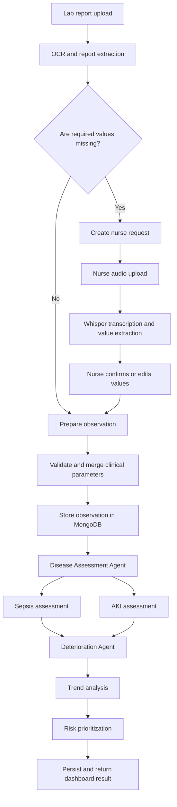

# MultiAgent-CDSS Project Guide

## 1. Project Summary

MultiAgent-CDSS is a research prototype for clinical decision support. It combines machine-learning disease models with software agents that collect clinical data, assess Sepsis and AKI risk, analyze patient trends, and prioritize deterioration.

The repository currently contains two related layers:

1. **Model and disease-agent layer**: reproducible Sepsis and AKI experiments, saved model artifacts, and deterministic disease assessment agents.
2. **Longitudinal application layer**: report OCR, nurse audio transcription, confirmation, MongoDB persistence, assessment orchestration, deterioration analysis, a FastAPI backend, and a React dashboard.

This is an academic prototype, not a clinically validated or production medical system. Model predictions are estimates and must not be used as a substitute for qualified clinical judgment.

## 2. End-to-End Workflow

The main application workflow is:



### Workflow stages

1. A report is uploaded with `patient_id` and `admission_id`.
2. `ReportInputAgent` extracts structured values from the report using OCR.
3. `InputOrchestrator` determines which required values are missing and creates a nurse request.
4. A nurse uploads an audio recording. `NurseAudioAgent` transcribes it with Whisper and extracts bedside values.
5. The nurse confirms or edits the extracted values.
6. `DataProcessingAgent` merges report and nurse values, validates the observation, and checks whether it is ready for Sepsis assessment.
7. The observation is stored through `PatientRepository` in MongoDB.
8. `DiseaseAssessmentAgent` loads the admission history and invokes the Sepsis and AKI tools.
9. `LLMDeteriorationAgent` loads the history, runs deterministic trend analysis and risk prioritization, and can use Gemini to plan the workflow.
10. Assessment and deterioration results are persisted and returned to the API/frontend.

The temporary report workflow state is held in the in-memory `pending_inputs` dictionary in the API. It is not a durable session store.

## 3. Repository Structure

```text
MultiAgent-CDSS/
|-- data/
|   |-- raw/                         Local source datasets
|   `-- processed/                  Generated/processed data
|-- models/                          Saved model artifacts and metrics
|   |-- aki/                         Baseline AKI artifacts
|   |-- aki_xgboost/                 Advanced AKI artifacts
|   |-- sepsis_lstm/                 LSTM artifacts
|   `-- temporal/                    Temporal Sepsis artifacts
|-- docs/                            Focused design and experiment notes
|-- frontend/                        React/Vite dashboard
|-- scripts/                         Database seed/load/reset utilities
|-- src/
|   |-- agents/                      Disease, trend, priority, and orchestration agents
|   |-- aki/                         AKI preprocessing and training
|   |-- api/                         FastAPI application
|   |-- database/                    MongoDB connection, models, repositories
|   |-- input/                       OCR, audio, input orchestration, processing
|   |-- sepsis/                      Sepsis preprocessing and training
|   `-- utils/                       Shared utilities
|-- tests/                           Higher-level and manual integration tests
|-- README.md                        Short setup overview
|-- documentation.md                 Older model-focused documentation
|-- PROJECT_GUIDE.md                 This current-state guide
`-- requirements.txt                 Python dependencies
```

Important source files:

| Area | Main files | Responsibility |
|---|---|---|
| API | `src/api/app.py` | FastAPI app, endpoints, dependency wiring |
| Workflow | `src/input/input_pipeline.py` | Coordinates report, audio, confirmation, storage, assessment |
| Report input | `src/input/report_input_agent.py` | OCR and report value extraction |
| Nurse input | `src/input/nurse_audio_agent.py` | Whisper transcription and bedside-value extraction |
| Data processing | `src/input/data_processing_agent.py` | Merge and validate clinical values |
| Disease orchestration | `src/agents/disease_assessment_agent.py` | Runs Sepsis and AKI assessments |
| Sepsis tool | `src/agents/sepsis_agent.py` | Temporal Sepsis model inference |
| AKI tool | `src/agents/aki_agent.py` | AKI model inference |
| Deterioration | `src/agents/llm_deterioration_agent.py` | History-based deterioration workflow |
| Trend analysis | `src/agents/trend_analysis_agent.py` | Deterministic change/trend calculations |
| Prioritization | `src/agents/risk_prioritization_agent.py` | Deterministic patient priority calculation |
| Database | `src/database/mongodb.py`, `repositories.py` | MongoDB access and clinical persistence |
| Sepsis ML | `src/sepsis/` | Preprocessing, temporal features, training, prediction |
| AKI ML | `src/aki/` | Preprocessing, splitting, training, XGBoost |

## 4. Setup on Windows

Run these commands from the repository root in PowerShell.

### 4.1 Create and activate a virtual environment

```powershell
python -m venv venv
.\venv\Scripts\Activate.ps1
```

If PowerShell blocks activation, use the virtual-environment interpreter directly:

```powershell
.\venv\Scripts\python.exe -m pip install -r requirements.txt
```

The activation command does not install or create the environment; it only changes the current shell. If `venv` does not exist, run the first command first.

### 4.2 Install Python dependencies

```powershell
python -m pip install -r requirements.txt
```

The repository's requirements file contains the scientific Python, TensorFlow, Jupyter, MongoDB, and environment packages. The application imports additional packages such as FastAPI, Uvicorn, XGBoost, Gemini, Whisper, OCR, multipart handling, and pytest. If a clean environment reports a missing import, install the package in that environment and record the dependency before deployment.

### 4.3 Configure environment variables

Create a local `.env` file in the repository root. Do not commit it.

```dotenv
MONGODB_URI=<MongoDB connection string>
MONGODB_DATABASE=MultiAgentCDSS
NURSE_AGENT_LLM_PROVIDER=openrouter
NURSE_AGENT_LLM_MODEL=openrouter/free
NURSE_AGENT_LLM_API_KEY=<OpenRouter API key>
REPORT_EXTRACTION_LLM_MODEL=deepseek/deepseek-chat
REPORT_EXTRACTION_LLM_API_KEY=<separate OpenRouter API key>
```

`MONGODB_URI` and `MONGODB_DATABASE` are used by the database layer. The Nurse Agent uses `NURSE_AGENT_LLM_API_KEY` for OpenRouter. Keep API keys in the local environment and never commit them.

### 4.4 Install external tools

The input agents also require:

- **Tesseract OCR** installed on Windows. The current implementation expects `C:\Program Files\Tesseract-OCR\tesseract.exe`.
- **Whisper model files**. `faster-whisper` may download a model on first audio use, so network access and sufficient disk space may be required.
- **MongoDB** access. Use a reachable local or hosted MongoDB instance with permissions for the configured database.

### 4.5 Confirm local data and model artifacts

The main expected raw datasets are:

```text
data/raw/sepsis/Dataset.csv
data/raw/aki/Raw_aki_patient_data.csv
```

The application also expects trained artifacts under `models/`. Large data and model files are kept local and may not be present after a fresh clone. Generate them with the training commands below or restore them from the project artifact source.

## 5. Running the Machine-Learning Pipelines

### 5.1 Train the Sepsis baseline models

```powershell
python -m src.sepsis.train
```

The Sepsis pipeline reads the raw CSV, preprocesses numeric and categorical data, trains baseline classifiers, evaluates them, and writes model/metric artifacts.

### 5.2 Run the Sepsis temporal/LSTM experiments

```powershell
python -m src.sepsis.lstm_model
```

The temporal workflow uses backward-looking features such as lag, change, percentage change, and rolling statistics. The LSTM experiment uses recent sequences of clinical variables. The saved artifacts are used by advanced inference when available.

### 5.3 Train AKI models

Baseline training is available through the AKI training module:

```powershell
python -m src.aki.train
```

The advanced XGBoost experiment is available through:

```powershell
python -m src.aki.xgboost_model
```

AKI is formulated as binary classification: `aki_stage == 0` means no AKI, while stages 1, 2, and 3 map to AKI. The strict baseline excludes target-defining or leakage-risk fields such as creatinine and urine-output fields.

### 5.4 Model artifacts

Common artifact groups include:

- `models/sepsis_metadata.json`, `sepsis_metrics.json`, and comparison CSV files.
- `models/temporal/` for temporal Sepsis features, metrics, and pipelines.
- `models/sepsis_lstm/` for the LSTM model, preprocessor, metadata, and threshold metrics.
- `models/aki/` for the baseline AKI pipeline and metrics.
- `models/aki_xgboost/` for the advanced AKI XGBoost model, preprocessor, feature importance, and metrics.

A model artifact normally stores both the fitted preprocessing transformation and estimator, or stores them as related files. Inference must use the same feature order and preprocessing assumptions as training.

## 6. Running the Disease-Agent Demos

From the repository root:

```powershell
python -m src.agents.demo_sepsis_agent
python -m src.agents.demo_aki_agent
python -m src.agents.demo_trend_analysis_agent
python -m src.agents.demo_risk_prioritization_agent
```

The disease demos use synthetic or sample structured data and saved models. The Sepsis agent accepts a patient history, validates patient identity and time ordering, creates temporal features, evaluates the latest observation, and returns a structured result. The AKI agent evaluates the latest structured observation against its required model features.

## 7. API Server

The FastAPI application is defined in `src/api/app.py`.

Start it from the repository root:

```powershell
.\scripts\start_backend.ps1
```

The interactive API documentation is then available at:

```text
http://127.0.0.1:8000/docs
```

The API initializes MongoDB, both disease agents, the Gemini planner, and the workflow pipeline during module import. Therefore environment variables, model files, and required runtime packages must be available before starting Uvicorn.

### API endpoints

#### `GET /api/health`

Checks that the API is running and attempts a MongoDB ping.

Example:

```powershell
Invoke-RestMethod http://127.0.0.1:8000/api/health
```

#### `POST /api/input/report`

Accepts a multipart upload containing:

- `patient_id`
- `admission_id`
- `report` file

The patient and admission must already exist. The endpoint stores a temporary workflow record and returns an `input_id` for the next step.

#### `POST /api/input/{input_id}/audio`

Accepts the nurse audio file for the pending report workflow. It returns extracted values and a confirmation state.

#### `POST /api/input/{input_id}/confirm`

Accepts JSON with the confirmed values:

```json
{
  "confirmed_parameters": {
    "HR": 92,
    "O2Sat": 96,
    "Temp": 37.2,
    "SBP": 118,
    "MAP": 82,
    "Resp": 18,
    "WBC": 8.5,
    "Lactate": 1.4
  }
}
```

The endpoint completes the observation, runs assessment and deterioration processing, and returns the combined result.

#### `GET /api/patients/{patient_id}/admissions/{admission_id}/history`

Returns persisted patient, admission, observations, assessments, trends, and prioritizations for the admission.

#### `GET /api/dashboard/patients`

Returns dashboard-oriented patient summaries, including latest available disease probabilities, risk levels, trend results, and priority values.

## 8. Frontend Dashboard

The frontend is a React 19 and Vite application in `frontend/`.

Install and start it in a second PowerShell terminal:

```powershell
cd frontend
npm install
npm run dev
```

Vite normally serves the frontend at:

```text
http://localhost:5173
```

The frontend calls the backend at `http://127.0.0.1:8000`. Run both servers for the complete application experience.

Available dashboard routes include:

- `/nurse` for report/audio collection and confirmation.
- `/doctor` for patient assessment and prioritization.
- `/clinical` for clinical dashboard views.

Frontend checks/build commands:

```powershell
npm run lint
npm run build
npm run preview
```

Main frontend files include `frontend/src/App.tsx`, `frontend/src/main.tsx`, `frontend/src/api/clinicalApi.ts`, and the page components under `frontend/src/pages/`.

## 9. Database Design

The database layer is implemented in `src/database/`.

`MongoDatabase` owns the MongoDB client and database connection. `PatientRepository` provides application-level persistence methods and keeps records scoped by `patient_id` and `admission_id`.

The main collections are:

- `patients`: patient identity and demographic context.
- `admissions`: admission-level context.
- `observations`: timestamped clinical parameters and their source.
- `assessments`: Sepsis and AKI model results.
- `trends`: disease-specific trend analysis results.
- `prioritizations`: overall risk/priority output.

Useful database scripts include:

```powershell
python scripts/seed_patients_from_dataset.py
python scripts/load_historical_observations.py
python scripts/reset.py
python -m src.database.initialize_database
```

Review each script before running it against a shared database. Reset utilities can remove data.

Tests use an in-memory database implementation where possible, which avoids requiring MongoDB for repository unit tests.

## 10. Agent Responsibilities

### `SepsisDetectionAgent`

- Validates that a history is non-empty and belongs to one patient.
- Requires an ordering/time field.
- Reuses temporal feature functions from `src/sepsis/temporal_features.py`.
- Selects the latest observation.
- Loads the trained preprocessing/model artifact.
- Returns probability, threshold, prediction, risk level, and status.

### `AKIDetectionAgent`

- Validates the structured feature dictionary.
- Checks required feature names, numeric values, and finite values.
- Loads the baseline or advanced AKI artifact.
- Returns a structured probability and risk result.

### `DiseaseAssessmentAgent`

This is the higher-level deterministic orchestrator. It retrieves admission history, runs Sepsis first, then AKI, records a reason/action/observe trace, handles partial failures, stores the combined assessment, and returns both results.

Missing required features are represented as `insufficient_data`; unexpected failures are represented as `error`.

### `TrendAnalysisAgent`

Computes changes and deterioration signals from historical observations. It is deterministic and should remain the source of numeric trend calculations.

### `RiskPrioritizationAgent`

Combines available disease assessment and trend signals into an operational priority such as high, medium, low, pending, or unknown.

### `LLMDeteriorationAgent` and `GeminiPlanner`

These components can use an LLM to select or plan workflow actions. The LLM should coordinate tools and interpret workflow state; it is not the source of the numeric disease probability. Disease scores, trend calculations, and priority calculations come from the deterministic tools and frozen model artifacts.

## 11. ML Design

### Sepsis

Sepsis is treated as a longitudinal problem. Patient observations are ordered by time and split at patient level to prevent the same patient appearing in both training and test data. The temporal feature set includes previous values, changes, safe percentage changes, and rolling statistics for clinical variables such as heart rate, oxygen saturation, temperature, blood pressure, respiratory rate, WBC, and lactate.

The dataset is highly imbalanced, so recall, precision, F1, ROC-AUC, and especially PR-AUC are more informative than accuracy alone. A high accuracy value can simply reflect the majority negative class.

### AKI

AKI is treated as an observation-level binary problem because the source data does not provide a usable longitudinal patient identifier for the implemented split. The pipeline uses stratified observation-level splitting. The strict feature set excludes `aki_stage` and fields that may directly define the target, including creatinine and urine-output measurements.

The advanced AKI model uses a larger feature set and may therefore require many more fields than the normal report/nurse workflow currently provides.

## 12. Testing

Run the full Python test suite from the repository root:

```powershell
pytest -q
```

Useful focused commands include:

```powershell
python -m pytest -q src/sepsis/test_preprocessing.py
python -m pytest -q src/sepsis/test_split.py
python -m pytest -q src/agents/test_aki_agent.py
python -m pytest -q src/database/test_repositories.py
python -m pytest -q tests/test_sepsis_agent.py
```

Tests cover preprocessing, target creation, splitting, temporal feature behavior, thresholds, model training, disease-agent output, result schemas, trends, prioritization, repositories, and higher-level assessment behavior. Some files under `tests/` are manual integration tests and may require MongoDB, Gemini, OCR, audio models, datasets, and saved artifacts.

## 13. Known Limitations and Current Inconsistencies

1. **Dependency completeness**: the current `requirements.txt` does not clearly list every package imported by the newer application layer. A clean installation may need FastAPI, Uvicorn, XGBoost, Gemini, Whisper, pytesseract, rapidfuzz, python-multipart, and pytest.
2. **Secrets**: `.env` contains environment-specific credentials. It must remain uncommitted, and any exposed credential should be rotated.
3. **OCR portability**: the Tesseract executable path is Windows-specific and hard-coded.
4. **Temporary workflow state**: `pending_inputs` is process memory. Restarting the API loses pending report workflows, and multiple API workers do not share this state.
5. **AKI input coverage**: the standard input workflow collects a small set of bedside/Sepsis variables, while the advanced AKI artifact requires a substantially larger feature set. AKI may therefore return `insufficient_data` in normal workflows.
6. **Model validity**: the models are research outputs and have not been clinically validated, externally tested, calibrated, or approved for patient care.
7. **Documentation drift**: `documentation.md` and some focused docs describe an earlier architecture and may say that components are not implemented even though current source files exist.
8. **Manual integration assumptions**: full-pipeline tests may call older method names or expect external services and local artifacts. Treat them as integration checks that may need alignment with the current API.
9. **No production deployment configuration**: there is no complete deployment manifest, authentication/authorization layer, audit policy, migration strategy, or production observability configuration.

## 14. Recommended Startup Order

For a complete local demonstration:

1. Activate the Python environment.
2. Install Python dependencies and frontend dependencies.
3. Confirm model files and raw data are present.
4. Configure MongoDB and Gemini environment variables.
5. Confirm Tesseract is installed and reachable.
6. Seed a patient and admission if the database is empty.
7. Start the FastAPI server on port 8000.
8. Start the Vite frontend on port 5173.
9. Open `/nurse`, upload a report, provide nurse audio, and confirm the extracted values.
10. Review the resulting assessment in `/doctor` or `/clinical`.
11. Run focused tests before changing model or workflow code.

## 15. Useful References

- `README.md`: short repository setup.
- `documentation.md`: historical and experiment-focused implementation notes.
- `docs/advanced_model_agent_integration.md`: advanced model/agent integration.
- `docs/unified_patient_result_contract.md`: result contract notes.
- `docs/patient_database.md`: database design notes.
- `docs/trend_analysis_agent.md`: trend-analysis notes.
- `docs/risk_prioritization_agent.md`: prioritization notes.
- `docs/sepsis_lstm_experiment.md`: Sepsis LSTM experiment.
- `docs/aki_xgboost_experiment.md`: AKI XGBoost experiment.
